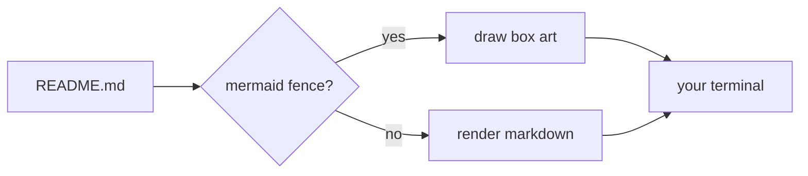
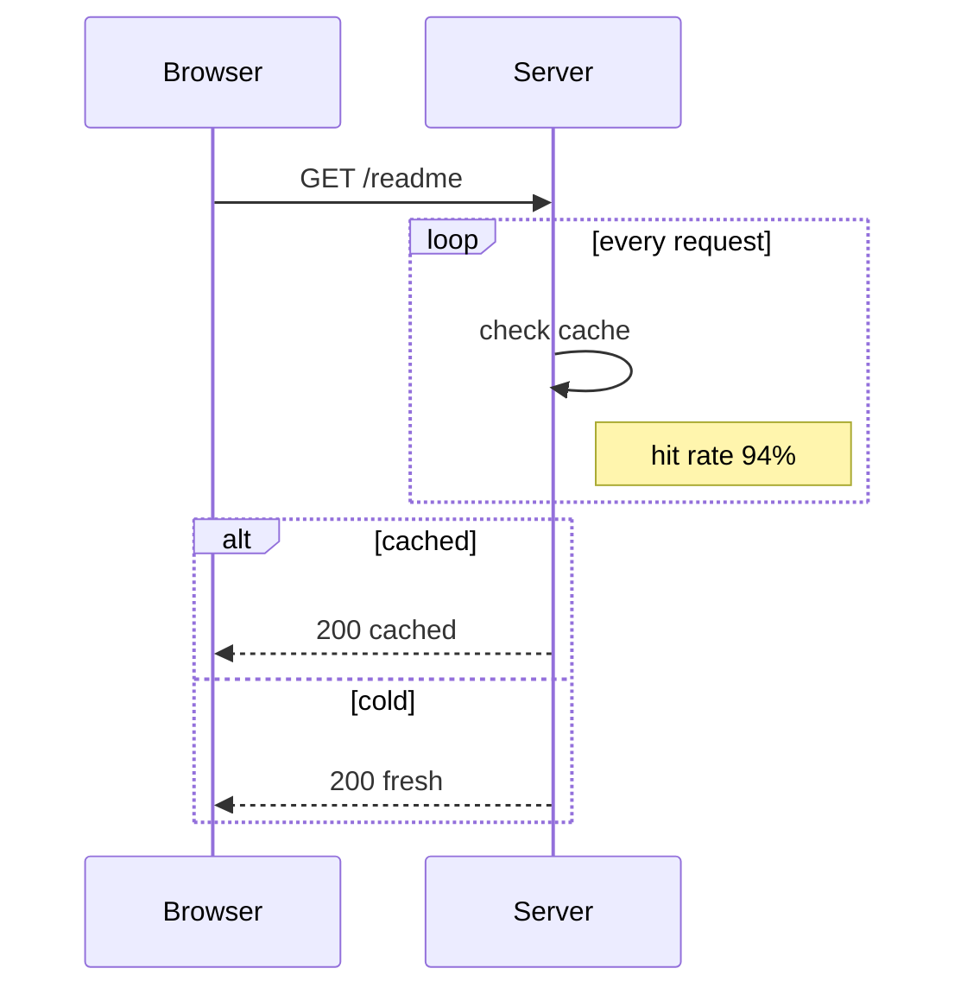
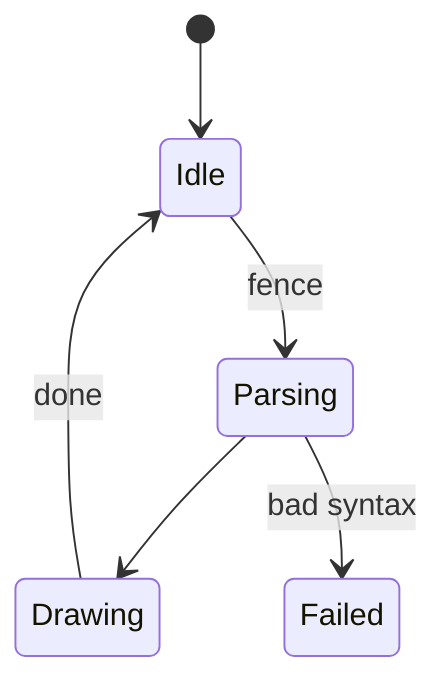
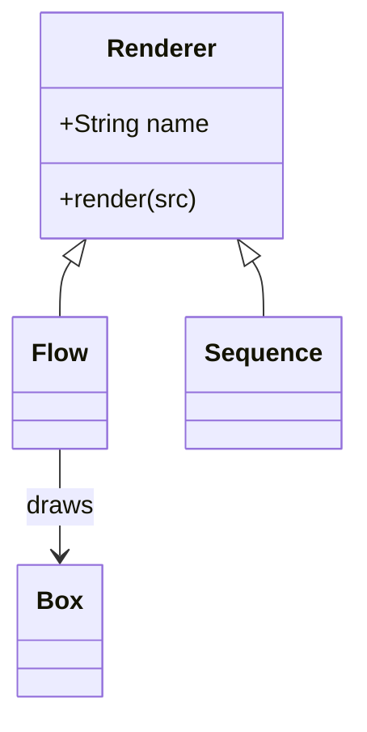
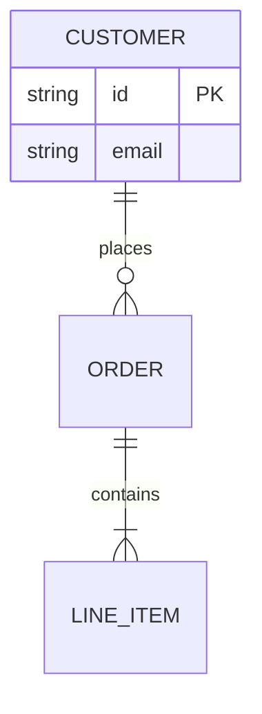

# mdv

**A markdown viewer that looks like it belongs on your desktop.**


The screenshots in this file are renders of real viewer frames, not mockups:
`mdv -frame` prints one frame, `tools/frame2svg.py` turns it into an SVG, and
`tools/screenshots.sh` regenerates all of them.

Your terminal already has a theme. Your bar, your editor and your file manager
already match it. Then you `cat README.md` and get a wall of plain text with a
table that wraps into nonsense.

`mdv` renders the README properly — headings, tables that fit the pane,
highlighted code, mermaid diagrams drawn as box art, clickable links, a
scrollbar you can drag — **in the colors of the theme you are already running**.

## Why this one

- **It reads your theme, it does not ship one.** On Omarchy that means the exact
  palette your desktop is wearing: `accent` on headings and links, `muted` on
  borders, `selection` behind inline code. Change the theme, `mdv` changes with
  it. No config file, no `--style` flag to remember.
- **Diagrams are drawn, not printed.** Every mermaid type `mdv` knows —
  flowchart, sequence, state, class, entity relationship — becomes box art in
  the flow of the document, with its shapes, labels, dashed edges and titled
  frames intact.
- **Tables that wrap, never clip.** Columns shrink down to their longest word
  and cells wrap; a table too narrow to lay out is printed as source instead of
  losing text. Borders follow the theme, headers are bold, `code` keeps its
  colour.
- **Links you can actually click.** Terminals hand clicks to the app, so a plain
  hyperlink would never fire inside a full-screen viewer. `mdv` recovers the
  link spans from the rendered output and opens the one you clicked.
- **Pictures stay pictures.** A README image is painted in place — with the
  kitty graphics protocol, iTerm2's inline images, sixel, or half blocks where
  none of those exist. Remote URLs are never fetched; a file that cannot be
  painted falls back to its alt text.
- **A scrollbar with a position, not a guess.** Thumb on the right edge, and a
  footer that says `42%` and `118/254` so you know where you are.

## Install

```sh
go install github.com/erans/mdv@latest    # needs Go 1.26+
# or from a clone
go build -o mdv .
```

## Use

```sh
mdv README.md            # open the viewer
mdv -w 100 README.md     # fixed width
cat x.md | mdv           # stdin
mdv -plain README.md     # print once, no viewer (what pipes get anyway)
mdv -palette             # show the resolved palette and exit
mdv -theme my.toml x.md  # use a specific colors.toml
mdv --toc README.md      # start with the contents pane open
```

| Flag | Does |
| --- | --- |
| `-w` | wrap width in columns (default: terminal width) |
| `-theme FILE` | a `colors.toml` to use instead of the desktop theme |
| `-plain` | print once instead of opening the viewer; automatic when not a TTY |
| `-palette` | print the resolved palette and exit |
| `-frame`, `-h` | print one viewer frame of `-h` rows and exit (screenshots, tests) |
| `-images MODE` | `auto` (default), `kitty`, `iterm2`, `sixel`, `halfblock`, `off` |
| `--toc` | open the contents pane on start (same as pressing `t`) |
| `-config PATH` | read another config file than `~/.config/mdv/config.json` |
| `-version` | print the version, OS and architecture and exit |
| `-man` | print the manual and exit |
| `-completions SHELL` | print completions for `bash`, `zsh` or `fish` and exit |

| Input | Does |
| --- | --- |
| wheel, `j`/`k`, `↑`/`↓` | scroll a line (the wheel moves three) |
| click or drag the scrollbar | jump, or scrub through the document |
| click a link | open it with `xdg-open` (`open` on macOS) |
| `d`/`u`, `space`, `PgUp`/`PgDn` | half a page |
| `g`/`G`, `Home`/`End` | top, bottom |
| `/` then text | search; `enter` jumps, `n`/`N` step, `esc` clears |
| `H`/`L`, `0` | scroll sideways when a diagram is wider than the pane, and back |
| `t` | table of contents pane; `j`/`k` move, `enter`/click jumps |
| `q`, `Esc`, `Ctrl+C` | quit (`Esc` first closes search or the pane) |

## Manual and completions

The binary carries its own documentation, so neither can drift from the flags it
actually has:

```sh
mdv -man > /usr/local/share/man/man1/mdv.1      # then: man mdv
mdv -man | man -l -                             # read it without installing

mdv -completions bash > /etc/bash_completion.d/mdv
mdv -completions zsh  > "${fpath[1]}/_mdv"
mdv -completions fish > ~/.config/fish/completions/mdv.fish
```

The manual covers the options, the viewer keys, the theme resolution order, the
config file, the supported mermaid types and the environment variables it reads.
Completions know the flags, the `-images` modes and the shell names, and fall
back to file completion for the file argument.

## Releasing

Releases are cut from `main` with one script, which also defines what a release
contains:

```sh
tools/release.sh v0.1.0             # test, build six binaries, tag
tools/release.sh v0.1.0 --publish   # …then push the tag and create the release
```

Each release carries `mdv_<version>_<os>_<arch>` archives for **linux** and
**darwin** on amd64 and arm64, and **windows** zips for the same two
architectures, each with the README and the man page inside, plus
`checksums.txt`. The binaries are static (`CGO_ENABLED=0`) and stamped with the
version, so `mdv -version` tells you what you are running.

Pushing a `v*` tag runs `.github/workflows/release.yml`, which calls the same
script and attaches the same assets to the GitHub release — so CI and a local
`--publish` cannot drift apart.

## Config file

Flags you type every time can live in `~/.config/mdv/config.json` (or
`$XDG_CONFIG_HOME/mdv/config.json`):

```json
{
  "toc": true,
  "images": "kitty",
  "width": 100,
  "theme": "~/themes/mine.toml"
}
```

Only the keys you write are applied, `~` is expanded, and **the command line
always wins**: `-toc=false` beats `"toc": true`. A missing file is normal and
silent; a malformed one prints a warning and mdv starts with your flags instead
of refusing to run.

## Finding your way


`/` opens a prompt in the footer; the count updates as you type, and every match
on screen is drawn with the theme's accent behind it. `enter` jumps to the first
one, `n` and `N` walk the rest, `esc` clears the search.

`t` opens the contents pane on the right — or start with it already open using
`mdv --toc README.md`. Headings are indented by level, the section you are
reading is in `accent`, the selected row in `selection`. `j`/`k` move, `enter`
or a click jumps, and the document re-wraps to the narrower width so nothing is
cut off. A document with no headings says `no headings` instead of showing an
empty column. Both features work on the rendered text, so nothing in
the markdown has to be annotated for them to work.

## Theme

Colors come from the first source that answers:

1. `-theme FILE`, or the active Omarchy theme —
   `~/.local/state/omarchy/current/theme/colors.toml`, then Omarchy 2's
   `~/.config/omarchy/current/theme/colors.toml`.
2. The terminal itself: OSC 10/11 and the ANSI hues, in one bounded query.
3. A built-in dark palette.

**The theme file wins over the terminal on purpose.** Over SSH your local
terminal is only a window onto someone else's desktop, so the remote theme
decides the colors — and whether the result is light or dark.

Everything renders against twelve palette roles (`accent`, `muted`, `selection`,
`foreground` and six hues). `palette.go` is the only file that holds hex
values; the renderers speak role names.

## Mermaid

Fences are drawn as box art, inline, in the flow of the document:


Every type `mdv` knows is drawn: `graph`/`flowchart`, `sequenceDiagram`,
`stateDiagram-v2`, `classDiagram`, `erDiagram`, `pie`, `gantt`, `journey` and
`mindmap`.

For flowcharts: `LR`, `RL`, `TD` and `TB`, square `[]`, rounded `()` and
decision `{}` nodes, `-->` `---` `-.->` `==>` edges with `|labels|` or
`-- labels -->`, chains (`A --> B --> C`), fan-out (`A --> B & C`) and
`subgraph name[Title]` frames, nested ones included.



Every edge reserves its own lane in the gap it crosses, so two arrows between
the same ranks never overlap, and a long edge swings around the boxes it skips
instead of cutting through them. A frame is sized around its members after the
layout, and a node that would fall inside somebody else's frame is pushed out
of it rather than enclosed by mistake.


A diagram wider than the pane is still drawn: `H` and `L` scroll it sideways and
`0` brings it back, with the offset in the footer. Only lines that overflow are
cut, so the prose around a diagram never moves. Plain output has no scrollbar to
offer, so it prints the source of a too-wide diagram instead of a wrapped mess;
a diagram type the renderer does not know prints its source in both modes.

### Sequence, state, class, entities, pie and gantt

| Sequence and state | Class and entities |
| --- | --- |
| [](docs/sequence.svg) | [](docs/models.svg) |


<details>
<summary>The four sources behind those screenshots</summary>









</details>

- **Sequence**: participant boxes and lifelines, `->>` solid and `-->>` dashed
  messages, self messages, labels centred between the lifelines, `loop`/`alt`/
  `opt`/`par`/`critical` frames with `else` dividers (nested too), and
  `Note over` / `Note left of` / `Note right of` boxes that hide the lifelines
  they cover.
- **State**: `[*]` start and end dots, `A --> B : label` transitions, cycles
  ranked by breaking back edges first so the diagram does not run downwards
  forever.
- **Class**: compartments for members, inheritance and association arrows
  pointing at the class the mermaid arrowhead points at.
- **Entities**: attribute rows inside the entity box, relationship labels from
  `A ||--o{ B : label`, whatever cardinality markers mermaid uses.
- **Pie**: shares as a horizontal bar chart with a hue per slice — a real pie is
  not drawable in box characters, and bars compare better anyway.
- **Gantt**: `section` headers, `done`/`active`/`crit` fills, milestones as `◆`,
  `after id` chains resolved to real dates, and a date axis over the whole span.
  Dates are `YYYY-MM-DD`; `dateFormat`/`axisFormat` are ignored.
- **Journey**: a section per phase, a five-cell score bar per step, and the
  actors beside it.
- **Mindmap**: an indented tree with box-drawing connectors. Shape wrappers
  (`root((text))`, `id[text]`), `::icon(...)` and `<br/>` are handled; the
  branches are drawn as a tree rather than curved around a centre.

## Images


A paragraph that is nothing but `` becomes the picture itself,
at the width of the pane:

- **kitty** — the graphics protocol, by terminal class name. Works in kitty,
  Ghostty, WezTerm and Warp.
- **iTerm2** — OSC 1337 inline images.
- **sixel** — for terminals that speak it, encoded here rather than shelled out.
- **half blocks** — `▀` with a foreground and background colour per cell. Not a
  protocol at all, so it works everywhere and scrolls with the text.

`-images` picks one; `auto` uses the protocol the terminal reports, and half
blocks inside the viewer, where scrolling redraws every line and a one-shot
graphics escape would be painted twice. Piping gets the protocol.

The cell size behind that arithmetic is asked for, not assumed: `CSI 16 t`, then
iTerm2's `ReportCellSize`, then the text area from `CSI 14 t` divided by the
grid, and 10x20 px only if a terminal answers nothing. The same round trip
fetches the palette, so it costs one bounded read at startup and only when the
document actually contains an image.

## How it works

- Markdown → ANSI is [glamour](https://github.com/charmbracelet/glamour), so
  text, code and syntax highlighting are not reinvented here. Tables are cut out
  first and laid out by `table.go`, because a cell must wrap rather than be
  clipped when the table lands on the wrap width, and because a border should
  take the theme's colour.
- Mermaid fences are cut out of the document before glamour sees them, drawn by
  the `mermaid` package, and spliced back in.
- The viewer is [bubbletea](https://github.com/charmbracelet/bubbletea), with a
  hand-drawn scrollbar and footer.
- Link spans are recovered by walking the rendered lines and counting visible
  columns while skipping SGR and OSC sequences, so a click maps to exactly the
  characters the terminal drew.
- `-frame` prints one viewer frame, so a screenshot is just a frame piped
  through `tools/frame2svg.py`. `tools/screenshots.sh` does that for every image
  in `docs/`:

  ```sh
  ./tools/screenshots.sh
  ```

## Known limits

- A decision node (`{}`) is drawn as a `╱──╲` frame, not a true diamond.
- Class relation arrowheads are one shape; UML's hollow triangles and diamonds
  are not distinguished.
- `direction` inside a `subgraph` is ignored; frames follow the diagram.
- Fences inside a list item or blockquote stay a code block.
- An edge label can end up touching a box corner when the gap is tight.
- Only local images are painted: `` stays alt text, and an image
  sharing a paragraph with text is left to the markdown renderer.

## Status

Done:

- [x] markdown, tables, syntax highlighting, hyperlinks
- [x] viewer: scrolling, scrollbar with progress, wheel, scrollbar scrub, clickable links
- [x] viewer: `/` search with highlights, `t` table-of-contents pane, `--toc` on start
- [x] Omarchy palettes, terminal queries, built-in fallback
- [x] own table renderer: wrapped cells, themed borders, nothing clipped
- [x] mermaid flowcharts as box art (LR/RL/TD/TB, shapes, labels, dashed edges)
- [x] `subgraph` frames with titles, nested frames, outsiders kept out
- [x] mermaid sequence, state, class and ER diagrams
- [x] mermaid `pie`, `gantt`, `journey` and `mindmap`
- [x] sideways scrolling for diagrams wider than the pane
- [x] config file for the flags you always type
- [x] man page (`-man`) and shell completions (`-completions`)
- [x] release script and tag-triggered workflow, six cross-built binaries
- [x] sequence `loop`/`alt`/`opt` frames, `else` dividers and notes
- [x] inline images via kitty graphics, iTerm2, sixel and half blocks

`go test ./...` covers the palette parser, the OSC reply parser, the link
recovery, the scrollbar math, the table layout, the mermaid layouts, the image
protocols and the frame layout.
