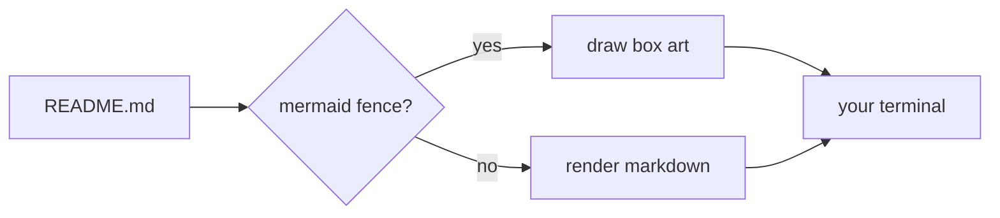

# mdv

**A markdown viewer that looks like it belongs on your desktop.**


Your terminal already has a theme. Your bar, your editor and your file manager
already match it. Then you `cat README.md` and get a wall of plain text with a
table that wraps into nonsense.

`mdv` renders the README properly — headings, tables that fit the pane,
highlighted code, clickable links, a scrollbar you can drag — **in the colors of
the theme you are already running**.

## Why this one

- **It reads your theme, it does not ship one.** On Omarchy that means the exact
  palette your desktop is wearing, `accent` on headings and links, `muted` on
  borders, `selection` behind inline code. Change the theme, `mdv` changes with
  it. No config file, no `--style` flag to remember.
- **Tables that behave.** Wide tables shrink their columns, wrap their cells and
  keep their borders. Narrow terminals get wrapped text, not truncated words.
- **Links you can actually click.** Terminals hand clicks to the app, so a
  plain hyperlink would never fire inside a full-screen viewer. `mdv` keeps the
  link spans from the rendered output and opens the one you clicked.
- **A scrollbar with a position, not a guess.** Thumb on the right edge, and a
  footer that says `42%` and `118/254` so you know where you are.

## Install

```sh
go install ./...     # or: go build -o mdv .
```

## Use

```sh
mdv README.md            # open the viewer
mdv -w 100 README.md     # fixed width
cat x.md | mdv           # stdin
mdv -plain README.md     # print once, no viewer (what pipes get anyway)
mdv -palette             # show the resolved palette and exit
mdv -theme my.toml x.md  # use a specific colors.toml
```

| Input | Does |
|---|---|
| wheel, `j`/`k`, `↑`/`↓` | scroll a line (the wheel moves three) |
| click or drag the scrollbar | jump, or scrub through the document |
| click a link | open it with `xdg-open` (`open` on macOS) |
| `d`/`u`, `space`, `PgUp`/`PgDn` | half a page |
| `g`/`G`, `Home`/`End` | top, bottom |
| `q`, `Esc`, `Ctrl+C` | quit |

## Theme

Colors come from the first source that answers:

1. `-theme FILE`, or the active Omarchy theme —
   `~/.local/state/omarchy/current/theme/colors.toml`, then Omarchy 2's
   `~/.config/omarchy/current/theme/colors.toml`.
2. The terminal itself: OSC 10/11 and the ANSI hues, in one bounded query.
3. A built-in dark palette.

**The theme file wins over the terminal on purpose.** Over SSH your local
terminal is only a window onto someone else's desktop, so the remote theme
decides the colors — and whether the result is light or dark.

Everything renders against twelve palette roles (`accent`, `muted`, `selection`,
`foreground` and six hues). No hex literals below `style.go`.

## Mermaid

Fences are drawn as box art, inline, in the flow of the document:


Supported today: `graph`/`flowchart` in `LR`, `RL`, `TD` and `TB`, square
`[]`, rounded `()` and decision `{}` nodes, `-->` `---` `-.->` `==>` edges with
`|labels|` or `-- labels -->`, chains (`A --> B --> C`) and fan-out
(`A --> B & C`).



Every edge reserves its own lane in the gap it crosses, so two arrows between
the same ranks never overlap, and a long edge swings around the boxes it skips
instead of cutting through them. A diagram too wide for the pane, or a type the
renderer does not know, is printed as source — never clipped.

Sequence, state, class and ER diagrams are next.

## How it works

- Markdown → ANSI is [glamour](https://github.com/charmbracelet/glamour), so
  text, code and syntax highlighting are not reinvented here.
- Mermaid fences are cut out of the document before glamour sees them, drawn
  by `mermaid.Render`, and spliced back in. Every edge reserves its own lane in
  the gap it crosses, so two arrows between the same ranks never overlap.
- The viewer is [bubbletea](https://github.com/charmbracelet/bubbletea), with a
  hand-drawn scrollbar and footer.
- Link spans are recovered by walking the rendered lines and counting visible
  columns while skipping SGR and OSC sequences, so a click maps to exactly the
  characters the terminal drew.
- `-frame` prints one viewer frame; `tools/frame2svg.py` turns it into the SVG
  screenshot at the top of this file:

  ```sh
  go build -o mdv .
  ./mdv -frame -w 86 -h 26 -theme testdata/tokyo-night.toml testdata/screenshot.md \
    | python3 tools/frame2svg.py > docs/screenshot.svg
  ```

## Status

- [x] markdown, tables, syntax highlighting, hyperlinks
- [x] viewer: scrolling, scrollbar with progress, wheel, scrollbar scrub, clickable links
- [x] Omarchy palettes, terminal queries, built-in fallback
- [ ] own table renderer (glamour truncates cells at the wrap boundary)
- [ ] `subgraph` frames and titles (members are drawn, the box is not)
- [x] mermaid flowcharts as box art (LR/RL/TD/TB, shapes, labels, dashed edges)
- [ ] mermaid sequence, state, class and ER diagrams
- [ ] inline images via kitty graphics, iTerm2 and sixel

`go test ./...` covers the palette parser, the OSC reply parser, the link
recovery, the scrollbar math and the frame layout.
