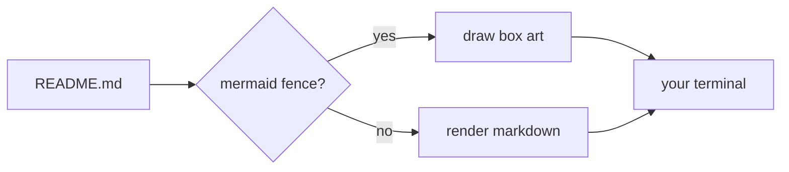
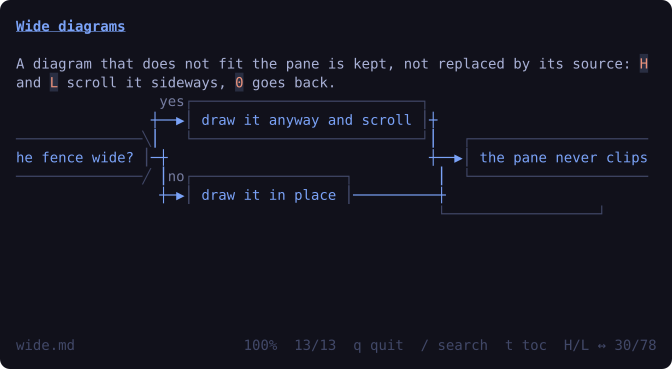
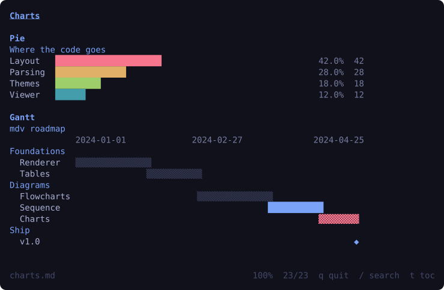
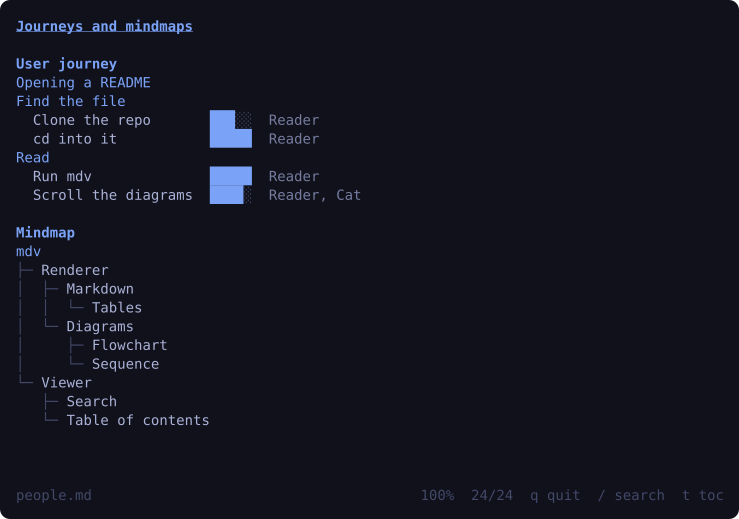
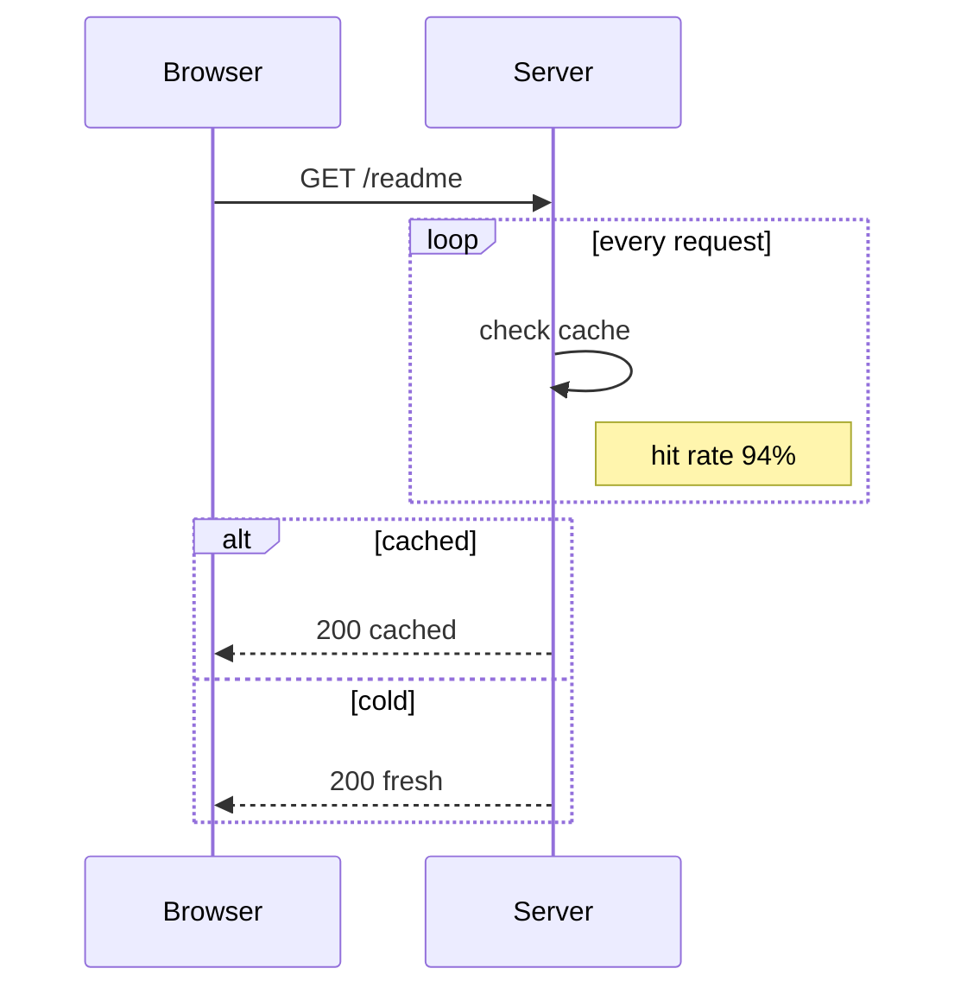
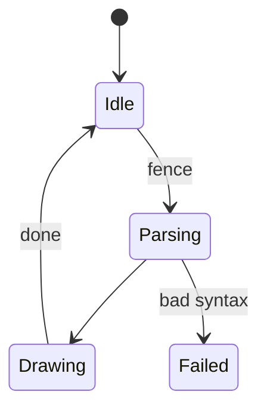
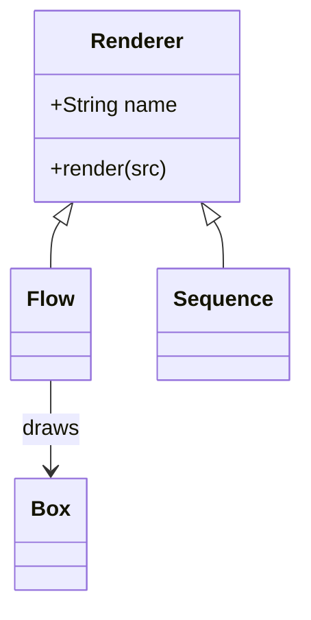
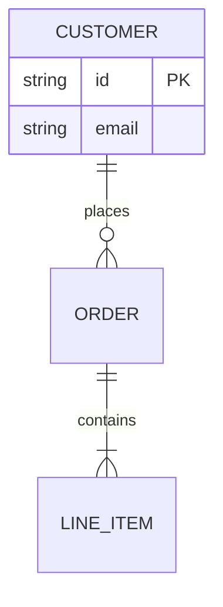
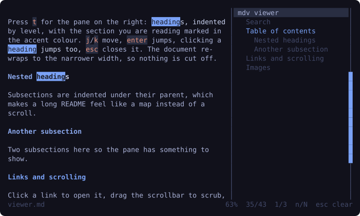

# mdv

**Markdown the way your desktop renders it.**


[](https://go.dev/dl/)
[](https://github.com/erans/mdv/releases/latest)
[](#pictures-stay-pictures)

You theme your bar, your editor, your file manager. Then you `cat README.md` —
and get a wall of monochrome text: a table wrapped into nonsense, a mermaid
diagram dumped as source code, links that go nowhere.

**mdv renders markdown like a page**: headings in your accent color, tables
that wrap instead of clip, syntax-highlighted code, links that actually open,
images painted in place — and **mermaid diagrams drawn as box art**, inline, in
the flow of the document. Plus a scrollbar you can drag, `/`-search with live
highlights, a table-of-contents pane, and sideways scrolling for diagrams
wider than your terminal.

It reads the palette your desktop is running. Change your theme tonight —
tomorrow mdv follows. No themes to pick. No style flags to remember.

> Every image in this README is a render of a real viewer frame — not a mockup.
> See [the receipts](#every-screenshot-is-real).

## Install

**Have Go 1.26+? One line:**

```sh
go install github.com/erans/mdv@latest
```

Make sure `$(go env GOPATH)/bin` is on your `PATH` and you are done.

**Rather not build? Grab a binary.** Every release ships static builds for
**Linux, macOS and Windows**, each on **amd64 and arm64**, with the man page
inside and a `checksums.txt` beside it:

**[↓ latest release](https://github.com/erans/mdv/releases/latest)**

```sh
tar -xzf mdv_*_linux_amd64.tar.gz      # or the .zip on Windows
install mdv_*/mdv /usr/local/bin/
mdv -version                           # mdv v0.1.0 (linux/amd64)
```

**From source:**

```sh
git clone https://github.com/erans/mdv
cd mdv
go build -o mdv .
```

## Use

```sh
mdv README.md          # the viewer: fullscreen, scrollbar, clickable links
mdv --toc README.md    # start with the contents pane open
mdv -w 100 README.md   # fixed width
mdv -plain README.md   # print once and exit — what pipes get anyway
cat notes.md | mdv     # straight from stdin
mdv -palette           # print the colors it resolved, and exit
mdv -theme mine.toml   # render in any colors.toml you like
```

Once it is open:

| Key | Does |
| --- | --- |
| wheel, `j`/`k`, `↑`/`↓` | scroll a line (the wheel moves three) |
| click or drag the scrollbar | jump, or scrub through the document |
| click a link | open it with `xdg-open` (`open` on macOS) |
| `d`/`u`, `space`, `PgUp`/`PgDn` | half a page |
| `g`/`G`, `Home`/`End` | top, bottom |
| `/` then text | search; `enter` jumps, `n`/`N` step, `esc` clears |
| `H`/`L`, `0` | scroll a wide diagram sideways, and back |
| `t` | contents pane; `j`/`k` move, `enter`/click jumps |
| `q`, `Esc`, `Ctrl+C` | quit (`Esc` first closes search or the pane) |

And the flags behind them:

| Flag | Does |
| --- | --- |
| `-w N` | wrap width in columns (default: terminal width) |
| `-theme FILE` | a `colors.toml` instead of the desktop theme |
| `-plain` | print once instead of opening the viewer; automatic when not a TTY |
| `-palette` | print the resolved palette and exit |
| `-images MODE` | `auto` (default), `kitty`, `iterm2`, `sixel`, `halfblock`, `off` |
| `--toc` | open the contents pane on start (same as pressing `t`) |
| `-config PATH` | read another config file than `~/.config/mdv/config.json` |
| `-version` | print the version, OS and architecture and exit |
| `-man` | print the manual and exit |
| `-completions SHELL` | print completions for `bash`, `zsh` or `fish` and exit |
| `-frame`, `-h`, `-find`, `-hscroll` | print one frame — how the screenshots below are made |

## It reads your theme — it doesn't ship one

Colors come from the first source that answers:

1. **`-theme FILE`** — or the Omarchy theme your desktop is running right now
   (`~/.local/state/omarchy/current/theme/colors.toml`, then Omarchy 2's
   `~/.config/omarchy/current/theme/colors.toml`).
2. **Your terminal**, asked politely: default foreground and background and the
   six ANSI hues, in one bounded query.
3. **A built-in dark palette** for when nothing answers.

**The theme file wins over the terminal on purpose.** Over SSH, your local
terminal is only a window onto someone else's desktop — so the remote theme
decides the colors, and whether the result is light or dark.

Everything renders against twelve palette roles — `accent` on headings and
links, `muted` on borders, `selection` behind inline code, six hues for the
rest. One file in the codebase holds hex values; the renderers speak role
names. Swap your desktop's theme and mdv follows without a restart.

## Mermaid, drawn — not dumped

Fenced mermaid blocks become box art, inline, in the flow of the document:


Flowcharts keep their direction (`LR`, `RL`, `TD`, `TB`), their square, rounded
and decision shapes, dashed and thick edges with labels, chains and fan-outs,
and titled `subgraph` frames — nested frames included. Every edge reserves its
own lane in the gap it crosses, so two arrows between the same ranks never
overlap, and a long edge swings around the boxes it skips instead of cutting
through them.



A diagram wider than the pane is still drawn — `H` and `L` scroll it sideways,
`0` comes back — and only the overflowing lines are cut, so the prose around it
never moves:



### All ten types

| Sequence and state | Classes and entities |
| --- | --- |
| [](docs/sequence.svg) | [](docs/models.svg) |





- **Sequence** — participant boxes and lifelines, `->>` solid and `-->>`
  dashed messages, self-messages, centred labels, `loop`/`alt`/`opt`/`par`/
  `critical` frames with `else` dividers (nested too), and `Note over`/
  `left of`/`right of` boxes that hide the lifelines they cover.
- **State** — `[*]` start and end dots, labelled transitions, cycles laid out by
  breaking back edges first so the diagram doesn't run downwards forever.
- **Class** — member compartments, inheritance and association arrows pointing
  where the mermaid arrowhead points.
- **Entity relationship** — attribute rows inside the entity, relationship
  labels whatever cardinality markers mermaid uses.
- **Pie** — shares as a horizontal bar chart, a hue per slice. (A real pie is
  not drawable in box characters, and bars compare better anyway.)
- **Gantt** — sections, `done`/`active`/`crit` fills, `◆` milestones, `after`
  chains resolved to real dates, a date axis over the whole span.
- **Journey** — a section per phase, a five-cell score bar per step, actors
  beside it.
- **Mindmap** — an indented tree with box-drawing connectors; shape wrappers and
  `::icon()` handled.

<details>
<summary>The sources behind those screenshots</summary>









</details>

## Tables that wrap, never clip

A table is only as good as its worst column. Columns shrink down to their
longest word, cells wrap — text is never cut off. A table too narrow to lay
out honestly prints its source instead of losing a word. Borders take the
theme's colors, headers are bold, and inline code, bold and links keep working
inside cells.

## Pictures stay pictures


A paragraph that is nothing but `` becomes the picture itself,
at the width of the pane — with whatever your terminal speaks:

- **kitty graphics protocol** — kitty, Ghostty, WezTerm, Warp
- **iTerm2 inline images** — OSC 1337
- **sixel** — encoded right here, not shelled out
- **half blocks** — `▀` with a foreground and background per cell; not a
  protocol at all, so it works everywhere and scrolls with the text

`auto` picks the protocol your terminal reports, and half blocks inside the
viewer where scrolling would repaint a one-shot graphics escape twice. Remote
URLs are never fetched; an image that cannot be painted falls back to its alt
text. The cell size behind the layout is queried from the terminal — the same
bounded round trip that fetches the palette — never assumed.

## Built for reading



`/` opens a prompt in the footer and the match count updates as you type;
every hit on screen is drawn with the theme's accent behind it. `t` opens the
contents pane: headings indented by level, the section you are reading in the
accent color, the selected row in `selection` — and the document re-wraps to
the narrower width so nothing is cut off. A document with no headings says so
instead of showing an empty column. Both work on the rendered text, so nothing
in the markdown has to be annotated for them to find it.

## Make it yours

Flags you type every time can live in `~/.config/mdv/config.json`:

```json
{
  "toc": true,
  "images": "kitty",
  "width": 100,
  "theme": "~/themes/mine.toml"
}
```

Only the keys you write are applied, `~` is expanded, and **the command line
always wins**: `-toc=false` beats `"toc": true`. A missing file is silent; a
malformed one warns and mdv starts with your flags instead of refusing to run.

The manual and shell completions ship inside the binary, so they cannot drift
from the flags it actually has:

```sh
mdv -man > /usr/local/share/man/man1/mdv.1    # then: man mdv
mdv -man | man -l -                           # read it without installing

mdv -completions bash > /etc/bash_completion.d/mdv
mdv -completions zsh  > "${fpath[1]}/_mdv"
mdv -completions fish > ~/.config/fish/completions/mdv.fish
```

Completions know the flags, the `-images` modes and the shell names, and fall
back to file completion for the file argument.

## Every screenshot is real

Nothing above is a mockup. `mdv -frame` prints one viewer frame,
`tools/frame2svg.py` turns it into an SVG, and one script regenerates every
image in this README:

```sh
./tools/screenshots.sh
```

## How it works

- Prose, code and syntax highlighting are [glamour](https://github.com/charmbracelet/glamour);
  mdv adds what glamour can't do: tables that wrap rather than clip, mermaid
  as box art, images, and borders that follow the theme.
- Mermaid fences are cut out of the document before glamour sees them, drawn
  by mdv's own `mermaid` package, and spliced back in.
- The viewer is [bubbletea](https://github.com/charmbracelet/bubbletea), with
  a hand-drawn scrollbar, live search and a contents pane.
- Clickable links work because mdv walks the rendered lines, counting visible
  columns while skipping ANSI escape sequences — so a click maps to exactly
  the characters the terminal drew.

`go test ./...` runs 87 tests across the palette parser, the OSC reply parser,
link recovery, scrollbar math, table layout, every mermaid layout, the image
protocols and the frame layout.

## Known limits

Honest ones, so you know what you are downloading:

- A decision node (`{}`) is drawn as a `╱──╲` frame, not a true diamond.
- Class relation arrowheads are one shape; UML's hollow triangles and diamonds
  are not distinguished.
- `direction` inside a `subgraph` is ignored; frames follow the diagram.
- Fences inside a list item or blockquote stay a code block.
- An edge label can touch a box corner when the gap is tight.
- Only local images are painted — `` stays alt text, and an image
  sharing a paragraph with text is left to the markdown renderer.
- Gantt dates are `YYYY-MM-DD`; `dateFormat`/`axisFormat` are ignored.
- The Windows binaries are cross-built but untested on a real Windows desktop,
  and clicking a link runs `xdg-open`, which Windows does not have.

---

Created on [LunaRoute](https://www.lunaroute.com) using DeepSeek 4.1 Flash
