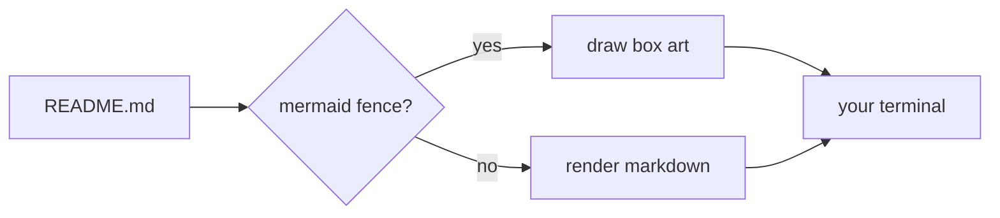

# mdv

A terminal markdown viewer that renders like the desktop it runs on.

## Mermaid fences are drawn, not printed

- shapes survive: `[]` square, `()` rounded, `{}` decision
- edges keep their direction, weight and labels
- a diagram that does not fit the pane is printed as source, never clipped

## Viewer

| Input | Does |
| --- | --- |
| wheel, `j`/`k` | scroll a line, the wheel moves three |
| click or drag the scrollbar | jump, or scrub through the document |
| click a link | opens it with `xdg-open` |

> Clicking a link works even though the terminal hands the app its clicks:
> the viewer recovers every link's columns from the rendered output.
