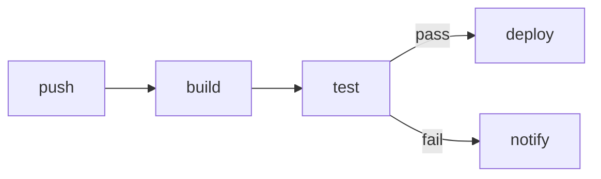
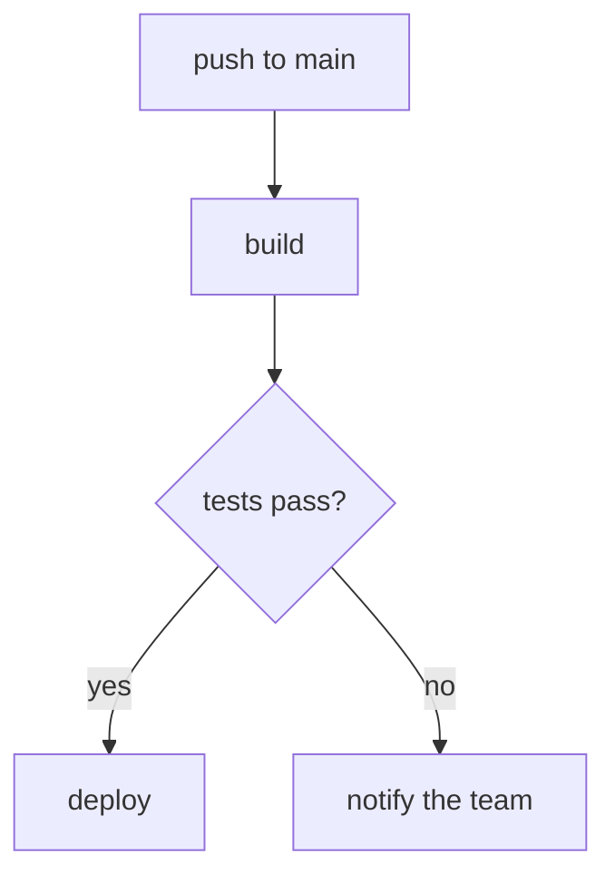
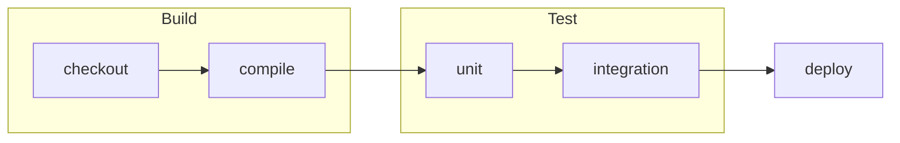

# Graphs and flowcharts

A mermaid fence is drawn where it stands, in the flow of the document.

## A pipeline

## A decision tree

## Groups become frames

## Shapes, directions, weights

| Fence | Draws |
| --- | --- |
| `graph LR` | left to right |
| `flowchart TD` | top to bottom |
| `A[x]` `B(y)` `C{z}` | square, rounded, decision |
| `-->` `---` `-.->` | arrow, line, dashed |
| `subgraph name[Title]` | a titled frame around its members |

- edges keep their labels, and two edges between the same ranks never overlap
- a diagram too wide for the pane is printed as source, never clipped
