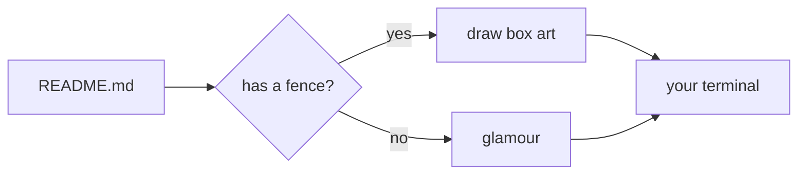

# mdv

A terminal markdown viewer that renders like the desktop it runs on.

## Theme

Colors come from the active Omarchy theme, so `mdv` matches your bar, your
terminal and your editor:

| Role | Source | Used for |
| --- | --- | --- |
| `accent` | `colors.toml` | headings, links, bullets, scrollbar thumb |
| `muted` | `colors.toml` | borders, quotes, footer, scrollbar track |
| `selection` | `colors.toml` | inline code chips |
| six hues | `colors.toml` | syntax highlighting |

```go
pal := resolvePalette("") // theme file, then terminal, then built-in
run(newViewer("README.md", src, pal))
```

## Mermaid



- **tables** that fit the pane instead of overflowing it
- **colors** taken from the desktop's own theme, not a hardcoded palette
- **links** you can click, a **scrollbar** you can drag
